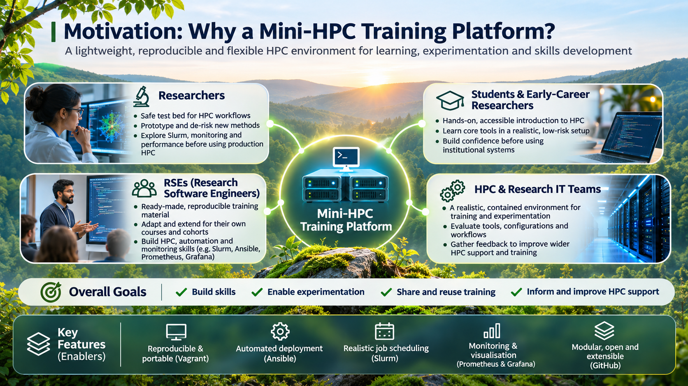
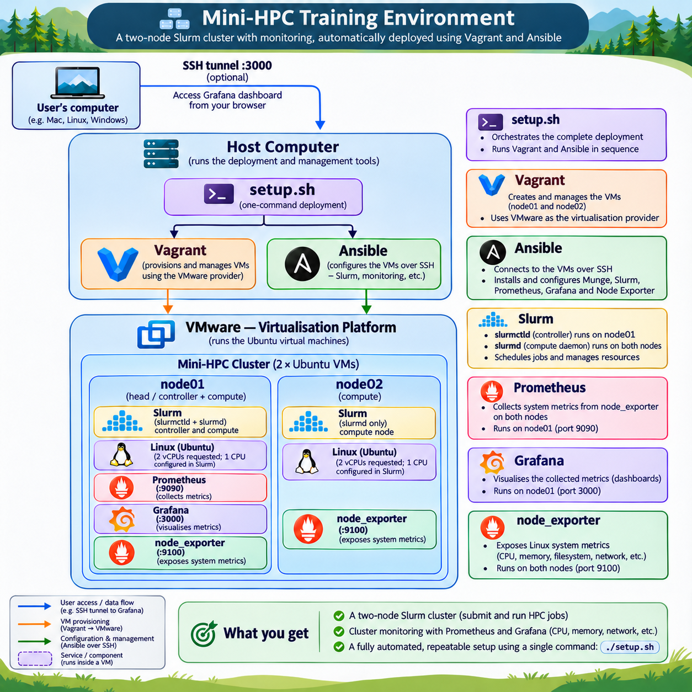

# Mini-HPC Training Environment

**A reproducible two-node High Performance Computing (HPC) training cluster using VMware, Vagrant, Ansible, Slurm, Prometheus and Grafana.**

**Designed by:**

**Dr. Tanmoy Chakraborty**

Research Software Specialist

Scientific Computing Research Technology Platform

University of Warwick

## Overview

This project provides a lightweight virtual HPC environment for introductory, hands-on training.

Participants can deploy their own two-node Ubuntu cluster and learn fundamental HPC concepts, including Linux commands, job scheduling, distributed computing and cluster monitoring.

The environment is automatically configured using Vagrant and Ansible.

## Why this project?

The Mini-HPC Training Environment aims to make HPC more accessible through a lightweight, reproducible and low-risk platform for learning and experimentation. **Researchers** can use it as a test bed for developing and validating HPC workflows before moving to production systems. **Research Software Engineers (RSEs)** can reuse and adapt the environment and training materials for their own students and research groups. **Students and early-career researchers** can gain hands-on experience with HPC concepts, while **HPC and Research IT professionals** can explore cluster administration, automation, monitoring and troubleshooting.

Ultimately, the goal is to encourage practical learning, knowledge sharing and wider adoption of HPC technologies.



*Motivation for the Mini-HPC Training Environment and its potential benefits across the research community.*

## Cluster architecture



*Architecture of the two-node mini-HPC training environment, showing Vagrant and Ansible automation, VMware virtualisation, Slurm job scheduling, and Prometheus/Grafana monitoring.*

The environment consists of two Ubuntu 24.04 virtual machines:

| Component | node01 | node02 |
|---|---|---|
| Role | Login, controller and compute | Compute |
| Slurm | Controller and compute daemon | Compute daemon |
| Munge authentication | Yes | Yes |
| Prometheus Node Exporter | Yes | Yes |
| Prometheus server | Yes | No |
| Grafana | Yes | No |

Each VM requests 2 GB RAM and 2 virtual CPUs. The current Slurm configuration allocates one CPU per node.

## Prerequisites

- VMware Workstation with a compatible licence
- Vagrant with the VMware Desktop provider and required utility
- Ansible and Python 3
- Git
- Internet connectivity
- Sufficient host RAM and disk space for two Ubuntu virtual machines

See **[Installation and Setup Guide](docs/installation-guide.md)** for more details.

The project has been tested using VMware on a Linux host.

## Quick start

Clone the repository and launch the deployment:

```bash
git clone https://github.com/tanmoy1989/mini-hpc-training.git
cd mini-hpc-training
./setup.sh
```

The script starts the virtual machines, discovers their IP addresses and configures the HPC services automatically.

Once deployment completes, connect to the controller:

```bash
vagrant ssh node01
```

Check Slurm:

```bash
sinfo
```

## Documentation

**[Installation and Setup Guide](docs/installation-guide.md)**

Detailed prerequisites, automated installation, cluster verification, Grafana access, troubleshooting and cleanup.

**[Hands-on HPC Training Exercises](exercises/hpc-training.md)**

A guided one-hour workshop introducing Linux, Slurm job scheduling, distributed execution and cluster monitoring.

## Project scope

This project is intended for educational use on trusted local networks, not production HPC workloads.

Slurm accounting, shared storage and advanced cluster management are outside the scope of the current introductory environment.

## Author

**Dr. Tanmoy Chakraborty**

Research Software Specialist

Scientific Computing Research Technology Platform

University of Warwick

GitHub: https://github.com/tanmoy1989
